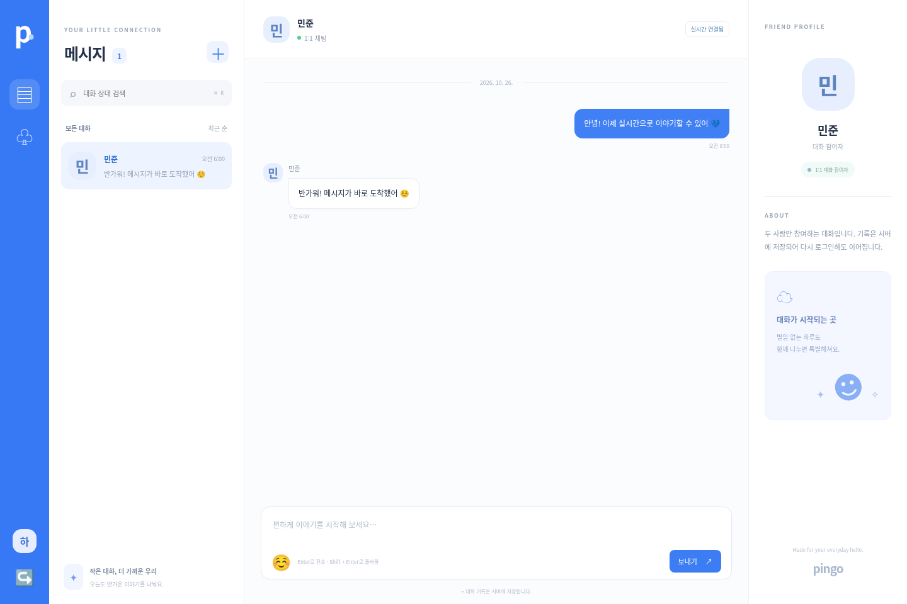
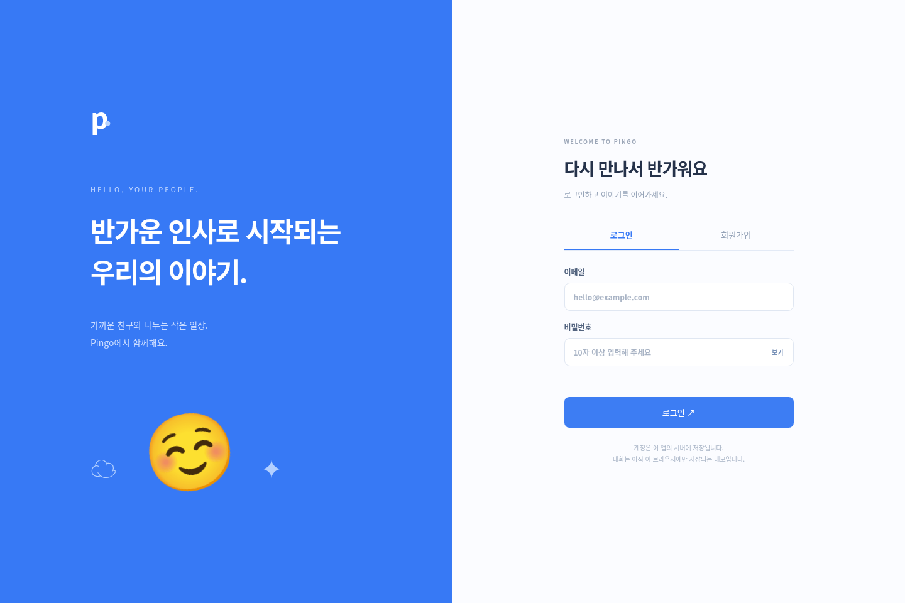

# Pingo

QQ에서 영감을 받은 파란색 테마의 **1:1 실시간 채팅 앱**입니다. 계정, 대화방, 메시지를 SQLite에 저장하고 SSE(Server-Sent Events)로 상대방 화면에 새 대화를 반영합니다. Node.js 24 이상에서 외부 패키지 설치 없이 동작합니다.

## 실행

```sh
npm start
```

기본 포트는 3000입니다. 다른 서버가 사용 중이면 `PORT=3003 npm start`처럼 변경하세요. 서로 대화할 사용자는 **같은 서버 주소**에 접속해야 합니다.

## 1:1 채팅 사용법

1. 이메일, 이름, 10~128자의 비밀번호로 회원가입합니다.
2. 다른 브라우저 또는 시크릿 창에서 두 번째 계정을 만듭니다. 같은 브라우저 프로필의 탭은 로그인 쿠키를 공유합니다.
3. 왼쪽 위 **＋** 또는 **친구** 메뉴에서 상대방의 이름(두 글자 이상) 또는 전체 이메일을 검색합니다.
4. 검색된 상대를 선택하면 1:1 대화방이 열립니다. 상대방에게도 대화방이 나타납니다.
5. 메시지를 보내면 상대 화면에 실시간으로 반영됩니다. Enter로 전송하고 Shift + Enter로 줄바꿈합니다.
6. 새로고침하거나 다시 로그인해도 서버에 저장된 대화를 이어갑니다. **이전 메시지 보기**로 과거 기록을 불러옵니다.

등록된 계정만 검색할 수 있습니다. 같은 두 사용자의 대화방은 하나로 유지됩니다. 오프라인 상태에서는 메시지를 보냈다고 표시하지 않고 입력을 유지합니다. 연결을 복구한 뒤 전송 버튼으로 다시 보낼 수 있습니다.

## 저장과 인증

- 기본 DB: `.data/pingo.sqlite`. 계정·세션·대화방·메시지가 서버 재시작 후에도 유지됩니다.
- `PINGO_DB_PATH`로 파일 경로를 변경할 수 있습니다. 배포 시 영구 볼륨을 연결하고 DB 백업을 구성하세요. DB·세션·환경 변수 파일은 Git에 포함하지 않습니다.
- 비밀번호는 무작위 salt와 scrypt로 해시하며, 세션 토큰도 해시로 보관합니다.
- 로그인은 HttpOnly·SameSite=Lax 쿠키로 7일간 유지됩니다. 로그아웃하면 해당 세션과 실시간 연결을 무효화합니다.
- 대화 조회·전송·이전 기록은 매 요청마다 로그인과 참여자 권한을 확인합니다. 전송자는 클라이언트 입력 대신 세션에서 결정합니다.
- 가입·로그인은 IP당 15분에 30회, 메시지 전송은 사용자당 분당 120회로 제한합니다. 제한 상태는 메모리에 저장되며 서버 재시작 때 초기화됩니다.
- 메시지는 1~2000자입니다. 전송 ID를 사용해 같은 요청을 다시 보내도 중복 메시지를 만들지 않습니다.
- 사용자 검색 결과에는 이름과 ID만 반환하며, 이메일 검색은 전체 주소가 일치할 때만 반환합니다.
- 기존 브라우저 localStorage 데모 기록은 서버에 자동 업로드하지 않으며, 새 채팅은 localStorage를 사용하지 않습니다.

## 실시간 운영

HTTP POST로 메시지를 저장하고, 세션 인증된 SSE 연결로 **대화 변경 알림만** 전달합니다. 클라이언트는 알림 수신 시 권한이 적용된 API에서 기록을 불러옵니다. 끊긴 연결은 자동 재연결하고 서버의 최신 기록과 동기화합니다. 세션 만료는 API 요청 및 SSE 하트비트(15초)에서 확인합니다.

현재는 **단일 Node.js 서버 인스턴스**용입니다. 리버스 프록시를 사용하면 `/api/events`의 응답 버퍼링을 끄고 장기 연결을 허용해야 합니다. 여러 서버 인스턴스에서 운영하려면 공유 DB와 Redis 등의 이벤트 전달 계층이 필요합니다. 사용자당 실시간 연결은 최대 10개입니다.

공개 배포는 HTTPS를 사용하고 `COOKIE_SECURE=true`로 실행하세요. 실제 온라인 상태, 읽음 표시, 파일 첨부, 이메일 소유 확인, 비밀번호 재설정, 차단 기능, 종단간 암호화는 아직 구현하지 않았습니다. Google Fonts 연결이 없으면 시스템 글꼴로 동작합니다.

## 검증

```sh
npm run check
npm test
```

테스트는 임시 DB와 별도 서버에서 수행하므로 실제 계정과 대화는 변경하지 않습니다. 인증 수명주기, 실시간 알림, 참여자 권한, 전송자 위조 차단, 중복 전송, 기록 페이지 조회, 서버 재시작 후 복원을 검증합니다.

## 실행 화면




