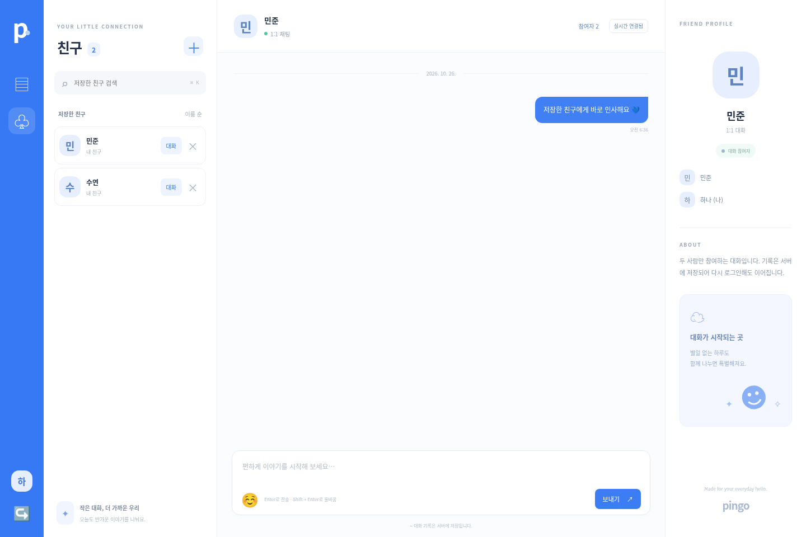
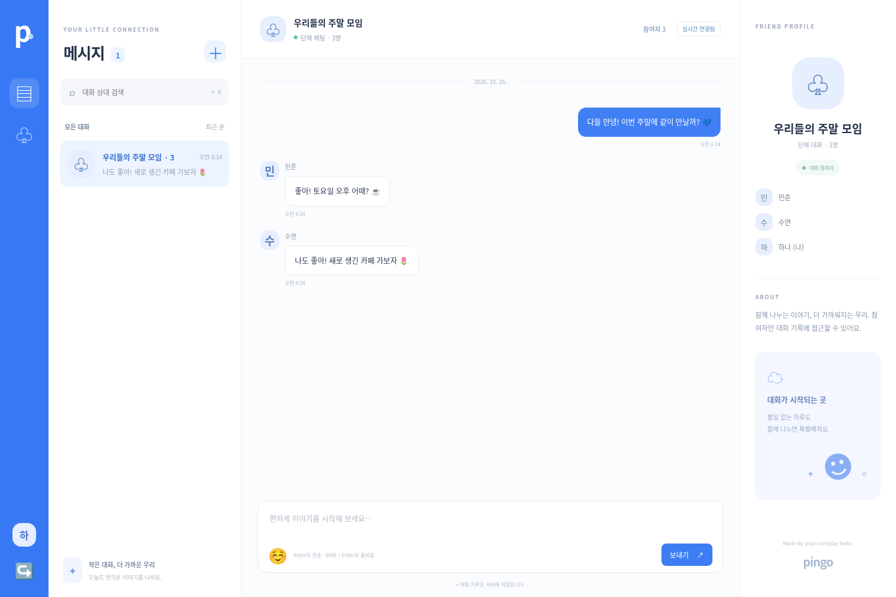

# Pingo

QQ에서 영감을 받은 파란색 테마의 **1:1 · 단체 실시간 채팅 앱**입니다. 계정, 친구 목록, 대화방, 메시지를 SQLite에 저장하고 SSE(Server-Sent Events)로 상대방 화면에 새 대화를 반영합니다. Node.js 24 이상에서 외부 패키지 설치 없이 동작합니다.

## 실행

```sh
npm start
```

기본 포트는 3000입니다. 다른 서버가 사용 중이면 `PORT=3011 npm start`처럼 변경하세요. 서로 대화할 사용자는 **같은 서버 주소**에 접속해야 합니다.

## 친구 저장

1. 왼쪽 **친구(♧)** 메뉴를 누르면 저장한 친구 목록이 열립니다.
2. **＋ → 친구 추가**에서 이름(두 글자 이상) 또는 전체 이메일로 가입자를 검색합니다.
3. 검색 결과의 **친구 추가**를 누르면 서버의 내 친구 목록에 저장됩니다. 이미 저장한 친구는 **추가됨 ✓**으로 표시됩니다.
4. 목록에서 이름으로 필터링하거나 **대화** 버튼으로 1:1 채팅을 시작할 수 있습니다.
5. 새 대화창의 **저장한 친구** 목록에서도 1:1 상대 또는 단체방 참여자를 바로 선택할 수 있습니다.
6. 친구 옆 **×**를 누르고 확인하면 내 목록에서만 삭제합니다. 기존 대화방·메시지와 상대방의 목록은 유지됩니다.

현재는 **개인 주소록 방식**입니다. 상대방 수락 없이 내 목록에만 저장하며, 상대방 목록에 나를 자동으로 추가하지 않습니다. 친구 요청·수락·차단은 아직 구현하지 않았습니다. 친구 저장만으로 대화방이 만들어지지는 않습니다. 기존 대화 상대를 친구로 자동 등록하지도 않습니다.

친구 목록은 계정별로 서버 DB에 보관되며, 다시 로그인하거나 다른 기기에서 접속해도 유지됩니다. 같은 계정의 다른 열린 창에는 실시간으로 변경을 반영합니다. 친구 저장 여부와 대화 참여 권한은 별개이며, 기존 가입자 검색을 통한 채팅도 계속 사용할 수 있습니다.

## 1:1 채팅 사용법

1. 이메일, 이름, 10~128자의 비밀번호로 회원가입합니다.
2. 다른 브라우저 또는 시크릿 창에서 두 번째 계정을 만듭니다. 같은 브라우저 프로필의 탭은 로그인 쿠키를 공유합니다.
3. 왼쪽 위 **＋ → 1:1 대화**에서 저장한 친구를 선택하거나 상대방의 이름(두 글자 이상) 또는 전체 이메일을 검색합니다.
4. 검색된 상대를 선택하면 1:1 대화방이 열립니다. 상대방에게도 대화방이 나타납니다.
5. 메시지를 보내면 상대 화면에 실시간으로 반영됩니다. Enter로 전송하고 Shift + Enter로 줄바꿈합니다.
6. 새로고침하거나 다시 로그인해도 서버에 저장된 대화를 이어갑니다. 대화창을 위로 스크롤하면 과거 기록을 자동으로 불러옵니다. **이전 메시지 보기** 버튼으로도 불러올 수 있습니다.

등록된 계정만 검색할 수 있습니다. 같은 두 사용자의 대화방은 하나로 유지됩니다. 오프라인 상태에서는 메시지를 보냈다고 표시하지 않고 입력을 유지합니다. 연결을 복구한 뒤 전송 버튼으로 다시 보낼 수 있습니다.

## 대화 고정·삭제

- 대화 목록에서 **우클릭**하거나 대화 옆 **⋯**를 누르면 **위로 고정 / 고정 해제 / 대화 삭제** 메뉴가 열립니다. 대화창 상단에서도 우클릭 또는 **⋯**로 같은 메뉴를 사용할 수 있습니다.
- 고정한 방은 일반 방보다 위에 표시되며, 여러 방을 고정하면 최근 고정한 방이 먼저 나옵니다. 설정은 계정별로 저장되어 다른 기기·재로그인·서버 재시작 후에도 유지됩니다.
- **대화 삭제**는 확인 후 **내 대화 목록에서만 숨기는 동작**입니다. 서버의 메시지, 참여 자격, 다른 참여자의 목록은 삭제하지 않습니다. 삭제할 때 고정도 해제합니다.
- 새 메시지가 오면 숨긴 방이 다시 표시됩니다. 1:1 방은 친구 목록이나 검색에서 다시 대화를 시작해도 복원됩니다. 복원하면 이전 기록을 그대로 볼 수 있습니다.
- 모바일은 대화 옆 또는 상단 **⋯**를 사용하세요. 키보드에서는 대화에 포커스하고 **Shift + F10**, 메뉴 안에서는 방향키·Enter·Escape를 사용할 수 있습니다.

## 대화 스크롤

메시지가 쌓여도 상단 정보와 하단 입력창은 고정되고 대화 영역만 스크롤됩니다. 최신 메시지를 보고 있을 때 새 메시지가 오거나 직접 전송하면 자동으로 맨 아래로 이동합니다. 과거 기록을 읽고 있으면 현재 위치를 유지합니다. **최신 메시지 ↓** 버튼을 누르면 맨 아래로 돌아옵니다.

위쪽 끝까지 스크롤하면 이전 기록을 50개씩 자동으로 불러오며, 기존에 읽던 메시지의 화면 위치를 유지합니다. 키보드로도 대화 영역에 포커스해 스크롤할 수 있습니다. 데스크톱과 모바일에서 150개 이상의 메시지로 검증했습니다.

## 단체 채팅 사용법

1. **＋ → 단체 대화**를 선택하고 방 이름(1~60자)을 입력합니다.
2. 친구의 이름이나 이메일을 검색하고 검색 결과를 눌러 선택합니다. 검색어를 바꿔도 선택은 유지되며 이름 옆 ×로 해제할 수 있습니다.
3. 친구를 2명 이상 선택한 뒤 **단체 대화 만들기**를 누릅니다. 생성자는 자동 포함되며, 총 3~50명까지 참여할 수 있습니다.
4. 선택한 모든 사용자의 대화 목록에 방이 나타납니다. 메시지마다 보낸 사람 이름이 표시됩니다.
5. 대화창의 **참여자** 버튼으로 전체 참여자를 확인할 수 있습니다. 모바일에서도 같은 버튼을 사용합니다.

현재 참여자는 방을 만들 때 정하며, 생성 후 추가 초대·내보내기·나가기·방 이름 변경은 지원하지 않습니다. 같은 멤버로 다른 이름의 방을 여러 개 만들 수 있습니다. 기존 1:1 방은 계속 하나로 유지됩니다.

기존 DB는 서버 시작 시 자동으로 단체방 지원 스키마로 변경됩니다. 기존 사용자, 로그인 세션, 1:1 대화방 ID와 메시지 기록을 보존합니다. 업그레이드 전에 기존 서버 프로세스를 종료하고 DB를 백업하세요. 여러 버전의 서버를 같은 DB에 동시에 연결하지 마세요. 마이그레이션과 참여자 생성은 트랜잭션으로 처리합니다.

## 저장과 인증

- 기본 DB: `.data/pingo.sqlite`. 계정·세션·친구 목록·대화방·메시지가 서버 재시작 후에도 유지됩니다.
- `PINGO_DB_PATH`로 파일 경로를 변경할 수 있습니다. 배포 시 영구 볼륨을 연결하고 DB 백업을 구성하세요. DB·세션·환경 변수 파일은 Git에 포함하지 않습니다.
- 비밀번호는 무작위 salt와 scrypt로 해시하며, 세션 토큰도 해시로 보관합니다.
- 로그인은 HttpOnly·SameSite=Lax 쿠키로 7일간 유지됩니다. 로그아웃하면 해당 세션과 실시간 연결을 무효화합니다.
- 대화 조회·전송·이전 기록은 매 요청마다 로그인과 참여자 권한을 확인합니다. 전송자는 클라이언트 입력 대신 세션에서 결정합니다.
- 가입·로그인은 IP당 15분에 30회, 메시지 전송은 사용자당 분당 120회로 제한합니다. 제한 상태는 메모리에 저장되며 서버 재시작 때 초기화됩니다.
- 메시지는 1~2000자입니다. 전송 ID를 사용해 같은 요청을 다시 보내도 중복 메시지를 만들지 않습니다.
- 사용자 검색 결과에는 이름과 ID만 반환하며, 이메일 검색은 전체 주소가 일치할 때만 반환합니다.
- 기존 브라우저 localStorage 데모 기록은 서버에 자동 업로드하지 않으며, 새 채팅은 localStorage를 사용하지 않습니다.

## 실시간 운영

HTTP POST로 메시지를 저장하고, 세션 인증된 SSE 연결로 **대화 변경 알림만** 전달합니다. 클라이언트는 알림 수신 시 권한이 적용된 API에서 기록을 불러옵니다. 끊긴 연결은 자동 재연결하고 서버의 최신 기록과 동기화합니다. 세션 만료는 API 요청 및 SSE 하트비트(15초)에서 확인합니다.

현재는 **단일 Node.js 서버 인스턴스**용입니다. 리버스 프록시를 사용하면 `/api/events`의 응답 버퍼링을 끄고 장기 연결을 허용해야 합니다. 여러 서버 인스턴스에서 운영하려면 공유 DB와 Redis 등의 이벤트 전달 계층이 필요합니다. 사용자당 실시간 연결은 최대 10개입니다.

공개 배포는 HTTPS를 사용하고 `COOKIE_SECURE=true`로 실행하세요. 실제 온라인 상태, 읽음 표시, 파일 첨부, 이메일 소유 확인, 비밀번호 재설정, 차단 기능, 종단간 암호화는 아직 구현하지 않았습니다. Google Fonts 연결이 없으면 시스템 글꼴로 동작합니다.

## 검증

```sh
npm run check
npm test
```

테스트는 임시 DB와 별도 서버에서 수행하므로 실제 계정과 대화는 변경하지 않습니다. 인증 수명주기, 실시간 알림, 참여자 권한, 전송자 위조 차단, 중복 전송, 기록 페이지 조회, 서버 재시작 후 복원, 단체방 생성 검증, 참여자별 접근, 실시간 다중 수신, 친구 저장·삭제·중복 방지·목록 소유자 권한·재로그인 및 재시작 후 유지, 대화 고정·숨김의 소유자 권한·순서·복원과 기존 DB 마이그레이션을 검증합니다.

## 실행 화면






